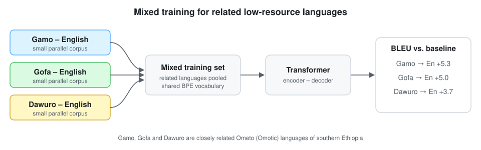

<div align="center">

# Neural Machine Translation for Low-Resource Ethiopian Languages
### Mixed training with a Transformer for Gamo, Gofa and Dawuro → English

[](https://doi.org/10.1007/978-3-031-19496-2_3)
[](https://doi.org/10.1007/978-3-031-19496-2_3)
[](#installation)
[](LICENSE)
[](https://github.com/marif561/Neural-Machine-Translation-for-Low-Resource-Languages/actions/workflows/tests.yml)

Project page for **"Improving Neural Machine Translation for Low Resource Languages Using Mixed Training: The Case of Ethiopian Languages"**, MICAI 2022, *Advances in Computational Intelligence*, Lecture Notes in Computer Science vol. 13613, pp. 30–40, Springer.

Atnafu Lambebo Tonja · Olga Kolesnikova · **Muhammad Arif** · Alexander Gelbukh · Grigori Sidorov

*Centro de Investigación en Computación, Instituto Politécnico Nacional (CIC-IPN), Mexico City*

</div>

---

## About the paper

Neural machine translation (NMT) works well for languages with large parallel corpora. It struggles with low-resource languages, especially when the little data that exists comes from a single domain. This paper looks at three closely related, low-resource Ethiopian languages: **Gamo**, **Gofa** and **Dawuro**, all from the Ometo group of the Omotic family. It proposes a **mixed-training** approach with a **Transformer** model that uses resources from related languages together. Compared with the baseline, translation into English improves by **+5.3 BLEU for Gamo**, **+5.0 for Gofa** and **+3.7 for Dawuro**.

A related poster, *Improving neural machine translation for low-resource languages using related language resources*, was presented by Tonja and Kolesnikova at the Black in AI affinity event at NeurIPS 2022.

<p align="center">
  
</p>

## Results

BLEU improvement over the baseline reported in the abstract:

| Language pair | BLEU gain |
|---|:-:|
| Gamo → English | **+5.3** |
| Gofa → English | **+5.0** |
| Dawuro → English | **+3.7** |

Absolute BLEU scores, dataset sizes and the full experimental setup are in the paper ([DOI](https://doi.org/10.1007/978-3-031-19496-2_3)). They will be added to [`results/`](results/) as they are transcribed from the published tables.

## What this repository provides

A compact, tested **Transformer NMT pipeline** for running mixed-training experiments on related low-resource languages:

- **Single-pair training:** one model per language pair (the baseline setting)
- **Mixed training:** the parallel data of several related source languages is pooled into one training set, with an optional source-language tag (`<gamo>`, `<gofa>`, `<dawuro>`) at the start of each sentence, and each pair is evaluated separately
- Shared **SentencePiece BPE** vocabulary, a **Transformer** encoder–decoder (PyTorch), label smoothing and the inverse-square-root warm-up schedule
- **SacreBLEU** evaluation per language pair and a translation command

> **Important.** This README is written from the paper's public abstract and metadata. The code implements mixed training in the standard way described above. It is a reference pipeline, **not** the authors' original code, and its default hyperparameters (in [`configs/`](configs/)) are common low-resource Transformer settings rather than values taken from the paper. Check the paper for the exact configuration.

## Repository structure

```
.
├── configs/transformer.yaml # Model and training settings
├── data/                    # Expected layout + tiny synthetic toy corpus
├── docs/figures/            # Mixed-training diagram
├── results/                 # Reported results as CSV
├── scripts/run_all.sh       # Baselines + mixed training for all three pairs
├── tests/                   # Unit tests (CI on every push)
└── src/ethiomt/
    ├── data.py              # Parallel corpus loading, mixing, language tags
    ├── tokenizer.py         # Shared SentencePiece BPE model
    ├── model.py             # Transformer encoder–decoder
    ├── train.py             # Single-pair or mixed training
    ├── translate.py         # Greedy decoding
    └── evaluate.py          # SacreBLEU per language pair
```

## Installation

```bash
git clone https://github.com/marif561/Neural-Machine-Translation-for-Low-Resource-Languages.git
cd Neural-Machine-Translation-for-Low-Resource-Languages
python -m venv .venv && source .venv/bin/activate
pip install -r requirements.txt
pip install -e .
```

## Data

Put one folder per language pair under `data/`, with line-aligned `train`, `dev` and `test` files:

```
data/gamo/   train.src  train.tgt  dev.src  dev.tgt  test.src  test.tgt
data/gofa/   ...
data/dawuro/ ...
```

`.src` is the Ethiopian-language side and `.tgt` is English. The paper's references point to the Gamo/Gofa/Dawuro–English parallel corpora by Tonja et al. (2021). Newer and larger data is available in [EthioMT](https://aclanthology.org/2024.rail-1.12) (Tonja et al., 2024). See [`data/README.md`](data/README.md).

## Usage

```bash
# Baseline: one model per pair
python -m ethiomt.train --data-dir data --langs gamo --out runs/gamo_single

# Mixed training: pool related languages, evaluate each pair
python -m ethiomt.train --data-dir data --langs gamo gofa dawuro --tags --out runs/mixed

# BLEU on each test set
python -m ethiomt.evaluate --run runs/mixed --data-dir data --langs gamo gofa dawuro

# Translate new sentences
python -m ethiomt.translate --run runs/mixed --lang gamo --input my_sentences.txt
```

`bash scripts/run_all.sh data` runs the three single-pair baselines and the mixed model, then prints a BLEU table.

To check the pipeline end to end in a minute on CPU, use the synthetic toy corpus:

```bash
python -m ethiomt.train --data-dir data/toy --langs toy_a toy_b toy_c --tags --config configs/tiny.yaml --out runs/toy
python -m ethiomt.evaluate --run runs/toy --data-dir data/toy --langs toy_a toy_b toy_c
```

## Citation

```bibtex
@inproceedings{tonja2022mixed,
  title     = {Improving Neural Machine Translation for Low Resource Languages Using Mixed Training:
               The Case of {Ethiopian} Languages},
  author    = {Tonja, Atnafu Lambebo and Kolesnikova, Olga and Arif, Muhammad and
               Gelbukh, Alexander and Sidorov, Grigori},
  booktitle = {Advances in Computational Intelligence. MICAI 2022},
  series    = {Lecture Notes in Computer Science},
  volume    = {13613},
  pages     = {30--40},
  publisher = {Springer, Cham},
  year      = {2022},
  doi       = {10.1007/978-3-031-19496-2_3}
}
```

## License

Code is released under the [MIT License](LICENSE). Parallel corpora are subject to their own licences.
